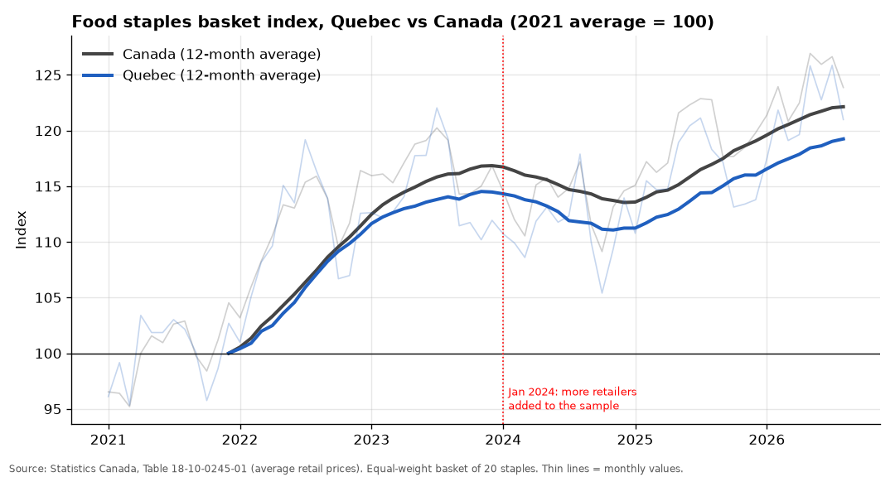
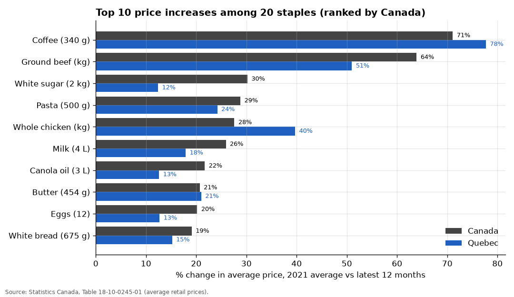
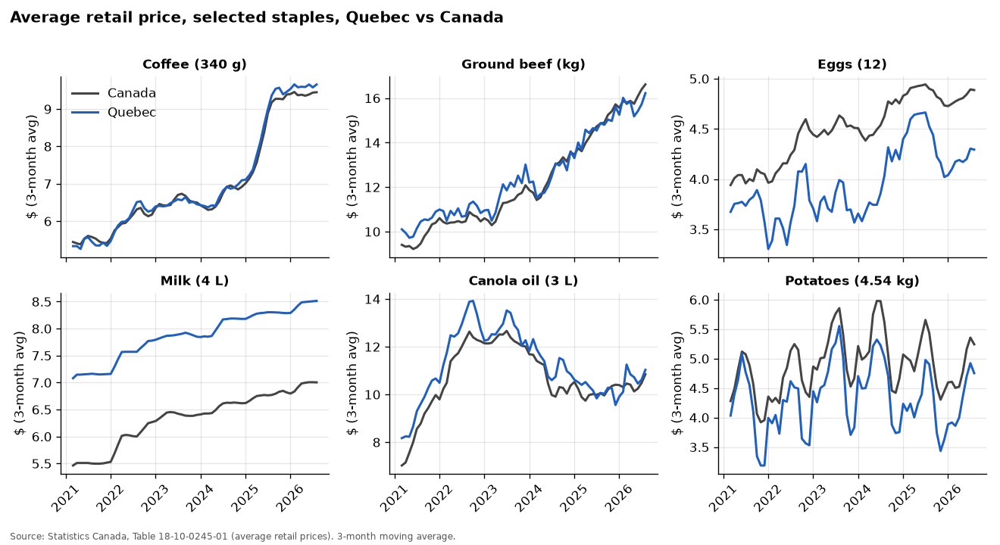
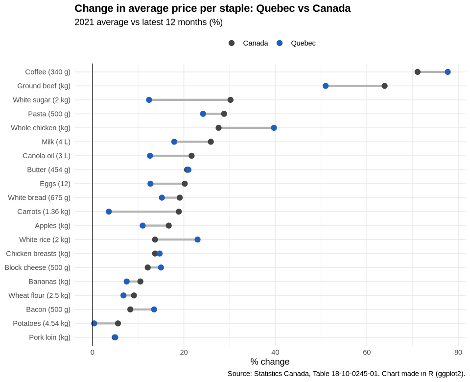

# Canada food prices tracker: Quebec vs Canada, 2021–2026

How much more do Canadians pay for everyday groceries than in 2021, which staples rose the most, and is Quebec different from the rest of the country?
This project answers that with Statistics Canada's monthly average retail prices, using **Python (pandas)**, **SQL (SQLite)** and a small **R** cross-check, with an explicit **data-quality** review.



## 1. Question

1. How much did the average price of a basket of 20 food staples change between 2021 and the latest 12 months, in Quebec and in Canada?
2. Which staples rose the most and the least?
3. Is the latest year-over-year change still high?
4. How do Quebec price levels compare with the national average?

## 2. Data

- **Statistics Canada, Table 18-10-0245-01, *Monthly average retail prices for selected products*** ([table page](https://www150.statcan.gc.ca/t1/tbl1/en/tv.action?pid=1810024501), DOI [10.25318/1810024501-eng](https://doi.org/10.25318/1810024501-eng)).
  Full-table CSV: `https://www150.statcan.gc.ca/n1/tbl/csv/18100245-eng.zip`, downloaded by `src/download.py`.
- Monthly, January 2017 to **August 2026** (latest month in the run used here), 110 products, Canada + 10 provinces + Whitehorse and Yellowknife. Prices are averages computed by StatCan from grocery retailers' **scanner (transaction) data**, taxes excluded ([methodology](https://www150.statcan.gc.ca/n1/pub/62f0014m/62f0014m2022007-eng.htm)).
- Subset used: **20 staples × 5 geographies** (Canada, Quebec, Ontario, Alberta, Saskatchewan), January 2020 to August 2026 → `data/processed/staples_prices.csv` (8,000 rows, ~0.7 MB). The raw file (19 MB) is not committed; run the download script.

| Category | Products (exact StatCan names) |
|---|---|
| Dairy & eggs | Eggs, 1 dozen · Milk, 4 litres · Butter, 454 grams · Block cheese, 500 grams |
| Meat | Whole chicken, per kilogram · Chicken breasts, per kilogram · Ground beef, per kilogram · Pork loin cuts, per kilogram · Bacon, 500 grams |
| Bakery & grains | White bread, 675 grams · White rice, 2 kilograms · Dry or fresh pasta, 500 grams · Wheat flour, 2.5 kilograms |
| Pantry | White sugar, 2 kilograms · Roasted or ground coffee, 340 grams · Canola oil, 3 litres |
| Produce | Potatoes, 4.54 kilograms · Carrots, 1.36 kilograms · Apples, per kilogram · Bananas, per kilogram |

**Licence and attribution.** Source: Statistics Canada, Table 18-10-0245-01, *Monthly average retail prices for selected products* (data to August 2026). Adapted and used under the [Statistics Canada Open Licence](https://www.statcan.gc.ca/en/reference/licence). This does not constitute an endorsement by Statistics Canada of this product.

## 3. Method

1. **Download** (`src/download.py`): fetches the full-table zip (standard library only, with retries).
2. **Clean** (`src/clean.py`): strips stray spaces in product names, converts prices to numbers, keeps the 20 staples and 5 geographies, and **asserts** the integrity rules: all products found, one unit (dollars), no duplicate months, no gaps.
3. **Data quality** (`src/data_quality.py` → [`outputs/data_quality.md`](outputs/data_quality.md)): see section 5.
4. **SQL** (`src/run_sql.py` loads the CSV into SQLite and runs [`sql/analysis.sql`](sql/analysis.sql); every result is saved to `outputs/sql/`):
   - year-over-year % change (self-join on the same month a year earlier);
   - cumulative change, **two ways**: January 2021 → latest month (point-to-point) and **2021 average → latest-12-month average** (used for rankings, because single months are noisy);
   - most / least inflationary items (window `RANK()`);
   - an **equal-weight basket index** (2021 average = 100): for each month, the mean of each item's price divided by its 2021 average price, plus a 12-month moving average.
5. **Charts** (`src/charts.py`, matplotlib) and **R** (`r/quebec_vs_canada.R`): R recomputes the basket index independently and checks it matches SQL (max difference 0.0000 over 340 month–geography pairs), then draws a ggplot2 chart.

The basket is **not the CPI**: each item counts equally regardless of household spending, and the underlying averages are not quality-adjusted (see limitations).

## 4. Findings (from the run on 2026-10-29, data to August 2026)

"Latest 12 months" = September 2025 – August 2026. All numbers are in `outputs/sql/`.

1. **The 20-staple basket costs about 22% more than in 2021 in Canada, and 19% more in Quebec.** Basket index (2021 = 100), latest-12-month average: Saskatchewan 126.3, Alberta 124.9, Ontario 123.3, **Canada 122.1, Quebec 119.3**. Quebec had the smallest rise of the five geographies (`q07_basket_summary.csv`).
2. **Coffee and ground beef are the outliers.** Coffee (340 g) is up **71%** in Canada and **78%** in Quebec (2021 average $5.48 → $9.38 in Canada); ground beef is up **64%** in Canada ($9.71 → $15.91 per kg) and **51%** in Quebec. Coffee's jump is recent: its average year-over-year change was 2% in 2024 and **28% in 2025**. Ground beef has risen every year since 2022 (`q03`, `q09`).
3. **The steepest year was 2022.** The Canada basket's annual average rose **11.4%** in 2022, then 4.9% in 2023, fell 2.8% in 2024, and rose 4.9% in 2025. The 2024 dip coincides with StatCan adding more retailers to the sample in January 2024, so part of it may be a method change rather than cheaper food (`q06`, data-quality §4).
4. **Some staples barely moved.** Smallest increases in Canada: pork loin **+4.9%**, potatoes **+5.6%**, bacon +8.3%, wheat flour +9.1%. In Quebec, potatoes are up only **0.4%** and carrots 3.6% (`q04`).
5. **Price growth has not stopped.** On a 12-month-average basis the Canada basket is **4.4%** above a year earlier (Quebec 4.2%). In August 2026 vs August 2025, ground beef was up **11.2%** and whole chicken 11.8% in Canada, while white sugar (−13.1%) and bacon (−14.1%) were cheaper (`q01`, `q05`).
6. **Quebec rose less than Canada for 12 of the 20 items, but levels differ by item.** Quebec's 4 L milk costs **21.5% more** than the Canadian average (down from 29.8% more in 2021; its staircase pattern is consistent with Quebec's regulated milk pricing). Eggs (87% of the Canada price), carrots (86%) and potatoes (87%) are cheaper in Quebec (`q08`).

How you measure matters: canola oil is up **58%** point-to-point (January 2021 → August 2026) but **22%** comparing 12-month averages, because January 2021 was a low month and prices peaked in 2022. That is why the rankings above use 12-month averages.







## 5. Data quality

Full generated report: [`outputs/data_quality.md`](outputs/data_quality.md). In short:

- **Missing values:** 34 of 141,432 rows (0.02%), all flagged `..` and all in Whitehorse and Yellowknife, which were only added from September 2025. The analysed subset has **0 missing values and no gaps** (116 months per series).
- **Units:** a single unit (dollars), one scale factor and 2 decimals across the table; one series ID (vector) per product × geography, nothing terminated. No unit changes to fix. But the package size is part of the product name, so `Milk, 1 litre` / `2 litres` / `4 litres` are separate series and must never be averaged together.
- **Naming problem:** 11 product names carry trailing spaces in the raw CSV (e.g. `"Brown rice, 900 grams "`). Exact-name filters silently drop these unless names are stripped.
- **Product definitions:** 10 of the 20 staples use a *standardized size* (packages within a size range rescaled to e.g. 500 g of cheese). Their average can move when the mix of brands and sizes people buy changes, even if no shelf price changes. StatCan warns that these averages "should not be used as a representative measure of pure price change".
- **Series break, January 2024:** additional retailers were added. In the staples subset the median absolute January month-to-month change was **4.3% in January 2024**, against 2.7–3.9% in the other Januaries: a visible but modest footprint.
- **Volatility / outliers:** 404 of 11,500 monthly changes (3.5%) are ±20% or more, mostly promotions or seasonal moves (e.g. Quebec potatoes +117% in November 2022, Quebec whole chicken +73% in May 2026). They were kept, not deleted, and handled by using 12-month averages.
- **Regional dependence:** Alberta and Saskatchewan (median gap 3.5%) and Nova Scotia and New Brunswick (2.1%) track each other much more closely than Quebec and Ontario (8.4%), so neighbouring provinces should not be read as independent confirmations.
- **Revisions:** StatCan revises this table; the download time is logged in `data/raw/DOWNLOADED_AT.txt`.

## 6. Limitations

- These are **average prices paid**, not a constant-quality price index. For inflation in the strict sense use the CPI (Table 18-10-0004-01). Changes here mix real price changes with changes in what people buy (brands, sizes, promotions).
- The basket is **equal-weight** and only 20 items: coffee counts as much as milk. It is a summary of these staples, not of a household grocery bill.
- Cross-province level comparisons carry StatCan's caution: brand and quality mixes differ by region.
- January 2024 sample change (more retailers) affects the 2024 year-over-year comparisons.
- Only 5 geographies were analysed; the territories were excluded (data only from September 2025, some values suppressed).

## 7. How to run

```bash
python -m venv .venv && source .venv/bin/activate
pip install -r requirements.txt
./run_all.sh        # download -> clean -> data quality -> SQL -> charts -> R (if installed)
```

Or step by step: `python src/download.py`, `python src/clean.py`, `python src/data_quality.py`, `python src/run_sql.py`, `python src/charts.py`, `Rscript r/quebec_vs_canada.R` (needs R ≥ 4.1 with `readr`, `dplyr`, `ggplot2`). Python 3.10+.

```
├── src/            download.py · clean.py · data_quality.py · run_sql.py · charts.py
├── sql/            analysis.sql
├── r/              quebec_vs_canada.R
├── data/raw/       (git-ignored; created by download.py)
├── data/processed/ staples_prices.csv
└── outputs/        charts (.png), data_quality.md, sql/*.csv
```

---

Built with the help of an AI assistant; analysis decisions and review by Sebastian Garcia.
Licence: [MIT](LICENSE) for the code. Data: Statistics Canada Open Licence.
